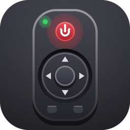
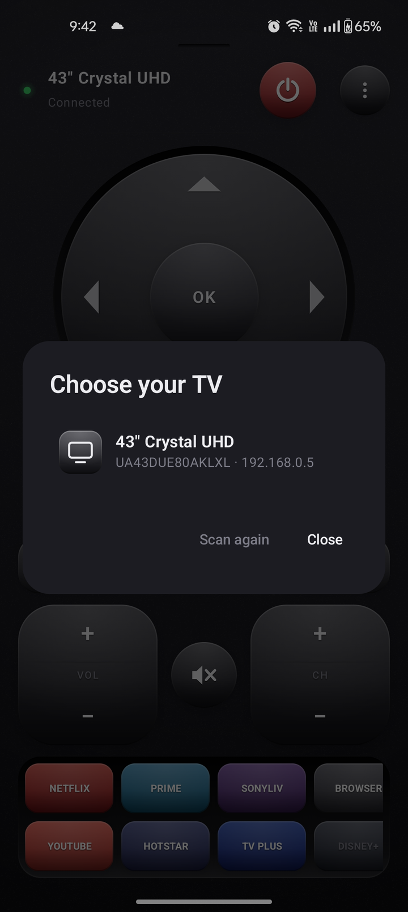
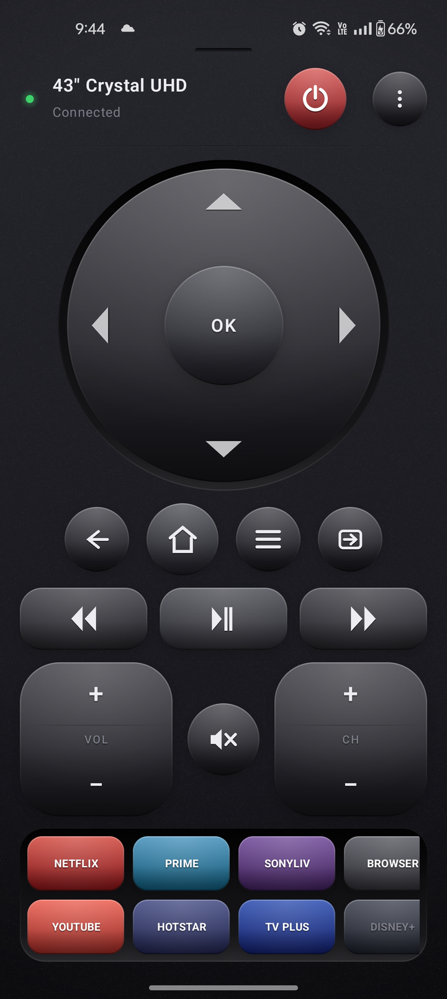
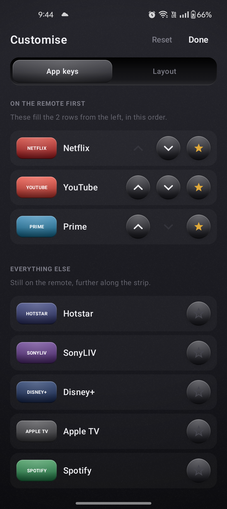

# Samsung Remote

A minimal Android remote control for Samsung Tizen smart TVs (2016 models and newer).

Kotlin, Jetpack Compose, Material 3. One screen, portrait, pure black, no scrolling. No ads,
no analytics, no tracking, no account, and no IP address to type.

> This is an independent, open-source project. It is not affiliated with, endorsed by, or
> supported by Samsung Electronics. "Samsung" and "Tizen" are trademarks of their respective
> owners and are used here only to describe which TVs the app works with.

<p align="center">
  
  &nbsp;&nbsp;
  
  &nbsp;&nbsp;
  
</p>

## Features

- **Finds your TV by name.** Scans the local network and lists what it finds — pick yours.
- **Reconnects by itself.** Pairs once, then connects silently every time you open the app.
- **Survives a changing IP.** Routers reassign addresses; the app tracks your TV by its own
  device id and follows it, so the pairing is never lost.
- Power, D-pad with OK, Back / Home / Menu / Source, media transport, volume and channel
  rockers.
- **Streaming shortcuts that match your TV.** The app knows ~27 apps and asks your set
  which of them it has; those sort to the front of the strip and the rest grey out, so
  everyone gets their own shortcuts without configuring anything.
- **Rearrangeable.** Star the apps you actually watch to pin them to the front of the
  strip, and move whole blocks of keys up and down the remote. Both are remembered.
- **Source key** for watching off a USB stick.
- Haptic feedback on every key, and every key works with TalkBack.

## Requirements

- An Android phone on **Android 7.0 (API 24)** or newer.
- A **Samsung Tizen TV from 2016 or later**. Older sets use a different, unencrypted
  protocol that this app does not speak.
- Phone and TV on the **same Wi-Fi network**. The TV is only reachable over the LAN.

## Using it

Open the app. If no TV is paired it goes straight to finding one — pick yours from the list
by name. After that it reconnects on its own, so the normal experience is: open, press
buttons.

Everything else is behind the **⋮** menu:

| Item | When it shows |
| ---- | ------------- |
| **Disconnect** | while connected |
| **Connect** | while disconnected, with a TV paired |
| **Customise remote** | always |
| **Connect to another TV** / **Find my TV** | always |
| **Forget this TV** | with a TV paired |

The app remembers **exactly one TV** — its device id, address, friendly name and access
token. Pairing a different one discards the previous pairing rather than accumulating
stale entries.

Reconnecting checks you are on Wi-Fi first and stays quiet on mobile data rather than
throwing errors at you; a TV that is simply switched off is reported in the header as
*Disconnected*, not as a pop-up. Starting a scan by hand on mobile data finds nothing,
because there is no local network to sweep.

### First connection

The TV shows an *Allow … to connect?* popup the first time. Choose **Allow** and it hands
back a token, which is saved — later launches connect silently.

If you choose **Deny**, the app clears the token; reconnect from the menu to get a fresh
popup.

### If your TV's address changes

Nothing to do. The app notices the saved address no longer answers as the same TV, finds it
again by its device id, and reconnects with the saved token. No popup, no re-pairing.

## Controls

| Control | Key sent |
| ------- | -------- |
| Power | `KEY_POWER` |
| D-pad | `KEY_UP` / `KEY_DOWN` / `KEY_LEFT` / `KEY_RIGHT` |
| OK | `KEY_ENTER` |
| Back / Home / Menu | `KEY_RETURN` / `KEY_HOME` / `KEY_MENU` |
| Source (USB, HDMI…) | `KEY_SOURCE` |
| Rewind / Play-pause / Forward | `KEY_REWIND` / `KEY_PLAY_BACK` / `KEY_FF` |
| Volume rocker | `KEY_VOLUP` / `KEY_VOLDOWN` |
| Mute | `KEY_MUTE` |
| Channel rocker | `KEY_CHUP` / `KEY_CHDOWN` |
| Streaming shortcuts | `POST /api/v2/applications/<id>` |

Play-pause is a single toggle key, which needs a 2016-or-newer set.

The remote fits one portrait screen — the D-pad takes whatever space the fixed rows leave,
so it adapts rather than overflowing wherever it is stacked. The app is locked to portrait
because a remote is a tall object; in landscape the fixed rows would not fit. The app keys
sit in two rows that scroll sideways together, filling down each column before moving
right, since the catalogue is longer than any phone is wide. The shell is drawn edge to
edge and the system bars are transparent, so the body runs the full height of the screen.

### Rearranging it

**⋮ → Customise remote** opens two tabs:

- **App keys** — star an app to pin it to the front of the strip; starred apps can be
  ordered with the arrows. Nothing is ever hidden, so an app your TV failed to report is
  still reachable further along.
- **Layout** — move the navigation pad, the round keys, playback and the rockers up and
  down. Reordering is done with arrows rather than dragging, because a slip here would
  cost you your arrangement.

**Reset** is always there, and resets only the tab you are on — restoring the order of the
key blocks and throwing away a starred list of apps are unrelated regrets, and one reset
that did both would make the safe one dangerous. It confirms first, saying which half goes
and which half stays, and greys itself out when that tab is already at its default.

Both arrangements are stored by enum name in their own preferences file, so adding apps or
sections in a later build cannot silently reshuffle a saved layout.

## Building

Needs **JDK 17 or 21**. Android Gradle Plugin 8.13 rejects newer JDKs — including the JDK 25
that recent Android Studio builds bundle — and the failure message is just the version
number, so point `JAVA_HOME` at a 17 or 21 explicitly. In Android Studio, set
*Settings → Build, Execution, Deployment → Build Tools → Gradle → Gradle JDK* to the same.

```bash
# macOS / Linux
export JAVA_HOME=/path/to/jdk-17
./gradlew installDebug
```

```powershell
# Windows
$env:JAVA_HOME = "C:\path\to\jdk-17"
.\gradlew.bat installDebug
```

The APK lands at `app/build/outputs/apk/debug/app-debug.apk`. Swap `installDebug` for
`assembleDebug` to build without a device attached.

Unit tests cover the pure parts — the subnet arithmetic, the catalogue matching and the
layout ordering:

```bash
./gradlew test
```

## How it works

A WebSocket to:

```
wss://<TV_IP>:8002/api/v2/channels/samsung.remote.control?name=<base64 app name>
```

plus `&token=<token>` once paired. Key presses are JSON frames:

```json
{
  "method": "ms.remote.control",
  "params": {
    "Cmd": "Click",
    "DataOfCmd": "KEY_VOLUP",
    "Option": "false",
    "TypeOfRemote": "SendRemoteKey"
  }
}
```

### Finding TVs

The app reads the **Wi-Fi interface's** address and prefix length and sweeps that subnet,
never wider than the containing `/24`. Each address gets a 400 ms TCP connect on 8001 and
8002; only hosts that answer get an HTTP request. Hosts that answer `:8001/api/v2/`
identify themselves by name, model and device id; hosts that don't are still listed by IP
so an unusual set is never hidden.

It reads `wlan0` directly rather than trusting `ConnectivityManager.activeNetwork`, because
on a phone with mobile data up the "active" network can be the cellular link — a `/27`
around `192.0.0.2`. Sweeping that finds nothing while looking exactly like an empty network.

This is ordinary TCP rather than a Wi-Fi scan, so it needs **no runtime permission** — no
location access, which SSDP/mDNS discovery would have required on Android 8.1+.

Two traps here, each of which costs a silently empty list:

- **Cleartext is blocked by default** from `targetSdk` 28, so the plain-HTTP probe throws
  `UnknownServiceException` while the raw TCP pre-check still succeeds — every TV looks
  like a non-TV. `res/xml/network_security_config.xml` permits it.
- **The info endpoint XML-escapes its strings.** A set named `50" Smart TV` arrives as
  `50&quot; Smart TV` and must be unescaped before display.

### Identifying a TV

By the device id (`uuid:…`) the TV reports, never by its address. Routers hand out a
different address every few days, and treating that as "a different TV" throws away the
access token and makes the set ask for approval all over again.

### Streaming shortcuts

Launching goes through the TV's REST API:

```
POST http://<tv>:8001/api/v2/applications/<appId>     ->  200 "true"
```

The older `ed.apps.launch` WebSocket event is **accepted silently and does nothing** on
current firmware, which makes it look like the app is broken rather than the call; it is
kept only as a fallback for pre-2020 models.

Tizen app ids are region- and rebrand-specific, so ids are resolved per TV rather than
assumed. On connect the app probes `GET /api/v2/applications/<id>` for every entry in its
catalogue — 200 means installed, 404 means not — and brings the apps that answered to the
front of the tray.

That is why no configuration is needed: the same build gives each person the apps on their
own set. The catalogue covers around 27 apps (Netflix, YouTube, Prime Video, JioHotstar,
SonyLIV, Disney+, Apple TV, Spotify, Twitch, Plex, Max, Hulu, Peacock, Paramount+,
Discovery+, iPlayer, ITVX, Tubi, Pluto TV, Rakuten, Apple Music, TIDAL, Deezer, YouTube
Kids, Steam Link, Samsung TV Plus, Browser). The tray slides sideways for the rest.

Apps the TV did not confirm are shown greyed rather than hidden, and **pressing one still
tries it** — working through that app's known ids and keeping whichever the TV accepts.
Probing can miss, and a set that will not enumerate its apps may be holding one it never
admitted to, so a greyed key is a guess worth offering rather than a dead end.

**To add your own app**, find its id and add an entry to the `TvApp` enum in
`app/src/main/java/com/samsung_remote/tv/TvApp.kt`:

```bash
# 200 = installed, 404 = not
curl "http://<tv-ip>:8001/api/v2/applications/<app-id>"
```

Public id lists are a good starting point. If an app is not in any of them, the ids are
structured — `3` + `YYYY` + `MM` + a 6-digit serial that climbs with release date — so the
space can be searched in a band around a predicted serial rather than brute forced.

### Watching from a USB stick

There is no deep link into USB contents: Tizen does not expose the media browser as a
launchable app, and no REST or WebSocket call reaches it. The **Source** key is as close as
the protocol allows — it opens the TV's input list, where the drive appears alongside the
HDMI inputs, and you pick it with the D-pad.

### Certificates

Tizen TVs serve a self-signed certificate on 8002, so the WebSocket uses an `OkHttpClient`
that accepts any certificate. It is private to `SamsungTv.kt` and used for nothing else.
Discovery talks plain HTTP on 8001 through a separate, ordinary client with certificate
validation intact.

Cleartext is permitted app-wide because Android's network security config has no CIDR
support, so "private ranges only" cannot be expressed. The app never contacts anything off
the local network.

### What is stored

Two small preferences files and nothing else: the paired TV (address, name, device id and
the access token the TV issued) and the remote's layout (section order and starred apps).
Both are included in Android's normal app backup, so restoring the app on a new phone
brings the pairing with it. The access token only works from inside the TV's own network.

## Troubleshooting

| Symptom | What to check |
| ------- | ------------- |
| Scan finds nothing | TV off, or the router isolates wireless clients (common on guest networks). |
| Scan finds nothing on a large network | Corporate and campus networks are often wider than a `/24`; the sweep only covers the `/24` around the phone. |
| Scan lists a bare IP with no name | That host has 8001/8002 open but would not describe itself. Tap it — if it is your TV it still connects. |
| *Join a Wi-Fi network* | You are on mobile data. The TV is LAN-only. |
| *The TV refused the connection* | Approval denied or revoked. On the TV: Settings → General → External Device Manager → Device Connect Manager → Device List, remove the entry, reconnect. |
| *Secure handshake failed* | Pre-2016 model. Those use a different, unencrypted protocol on 8001 that this app does not speak. |
| A shortcut is greyed out | The TV did not confirm that app is installed. Press it anyway — the app still tries, and the key lights up if the TV accepts. |
| Power on does nothing | Expected. A TV in standby is not listening unless it supports Wake-on-LAN, which this app does not implement. `KEY_POWER` turns it **off** reliably. |
| Build fails with just a version number | Wrong JDK. See [Building](#building). |

## Project layout

Two packages, split along the line that matters: `tv` knows the protocol and nothing about
Compose, `ui` knows the screen and nothing about sockets. The `tv` package has no Android UI
dependencies at all, so it can be lifted into another app as-is.

```
app/src/main/java/com/samsung_remote/
  MainActivity.kt        # Activity only: wires the pieces together, nothing else

  tv/                    # The TV. No Compose anywhere in here.
    SamsungTv.kt         #   Connection, pairing, key presses, launching apps
    TvScanner.kt         #   Subnet sweep, device identification
    TvApp.kt             #   The app catalogue, and connection state
    Keys.kt              #   Tizen key codes

  ui/                    # The remote. No sockets anywhere in here.
    RemoteScreen.kt      #   Composes the whole screen from the blocks below
    Palette.kt           #   Colours and the app-key tints
    Surfaces.kt          #   The moulded-plastic key and recess surfaces
    Key.kt               #   One key: press behaviour, haptics, repeat, accessibility
    Header.kt            #   TV name, status lamp, power, menu
    DPad.kt              #   The navigation wheel
    KeyRows.kt           #   Nav, media and rocker rows
    AppTray.kt           #   The sliding strip of app keys
    Chassis.kt           #   IR window and seam -- the shell's details
    Glyphs.kt            #   The key symbols, drawn rather than typed
    PickerDialog.kt      #   Choosing a TV
    RemoteLayout.kt      #   Saved section order and app favourites
    CustomiseScreen.kt   #   The screen that rearranges both

app/src/test/java/com/samsung_remote/
  tv/SubnetTest.kt       # Subnet sweep arithmetic and XML unescaping
  tv/TvAppTest.kt        # Catalogue matching and id hygiene
  ui/RemoteLayoutTest.kt # Reordering and the app strip's running order
```

- `minSdk` 24, `targetSdk` 36
- Dependencies: AndroidX Core / Lifecycle / Activity-Compose, Compose BOM + Material 3,
  OkHttp, kotlinx-coroutines. JUnit 4 for tests.

## Contributing

Bug reports and pull requests are welcome. The most useful contribution is an app id that
works on your TV — see [Streaming shortcuts](#streaming-shortcuts) for how to find one,
then add it to `TvApp.kt` with a short note on the model and region you verified it on.
Please run `./gradlew test lint` before opening a pull request.

## Licence

Copyright 2026 Debendra Prasad Sahu

Licensed under the [Apache License, Version 2.0](LICENSE). You may not use this project except
in compliance with the License. Unless required by applicable law or agreed to in writing,
software distributed under the License is distributed on an "AS IS" BASIS, without warranties
or conditions of any kind.

Samsung Remote is not affiliated with or endorsed by Samsung.
